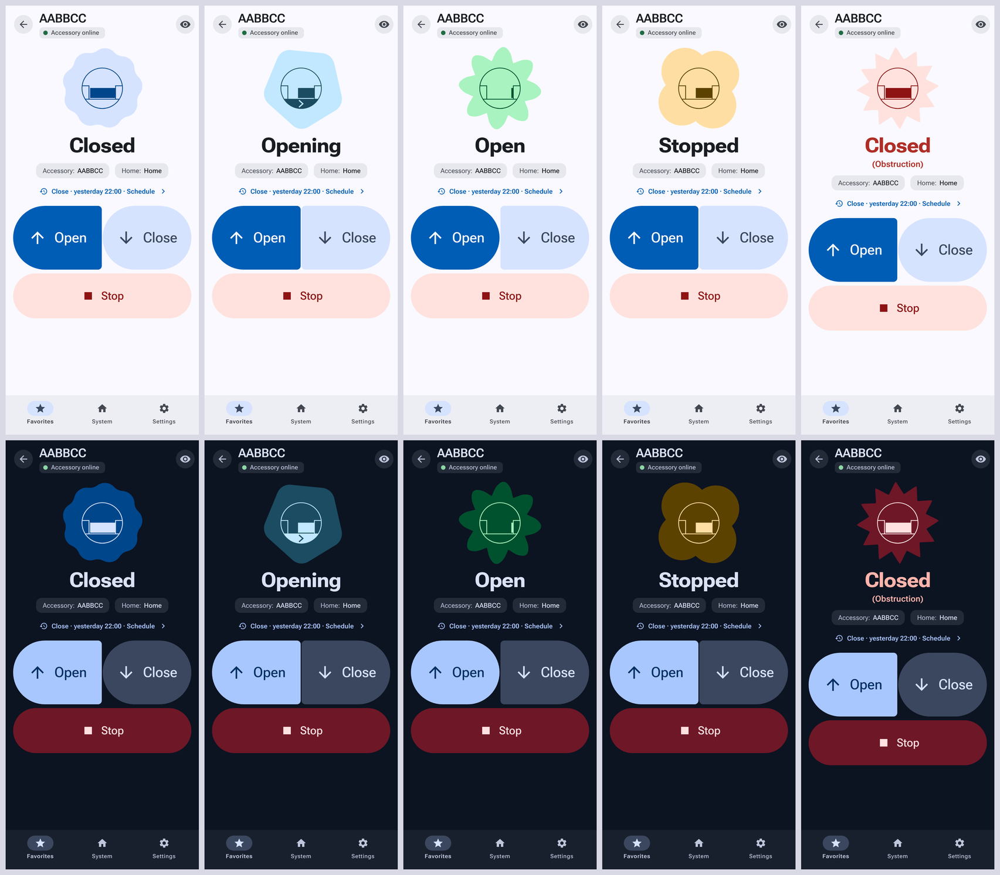
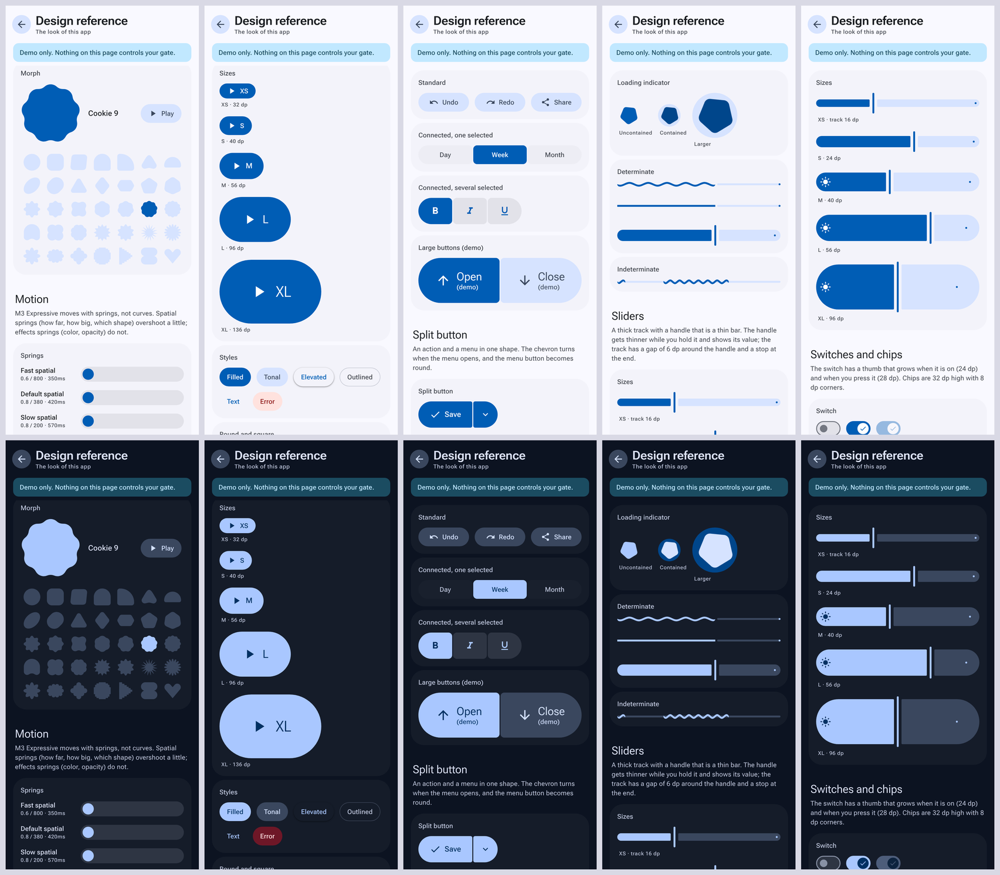
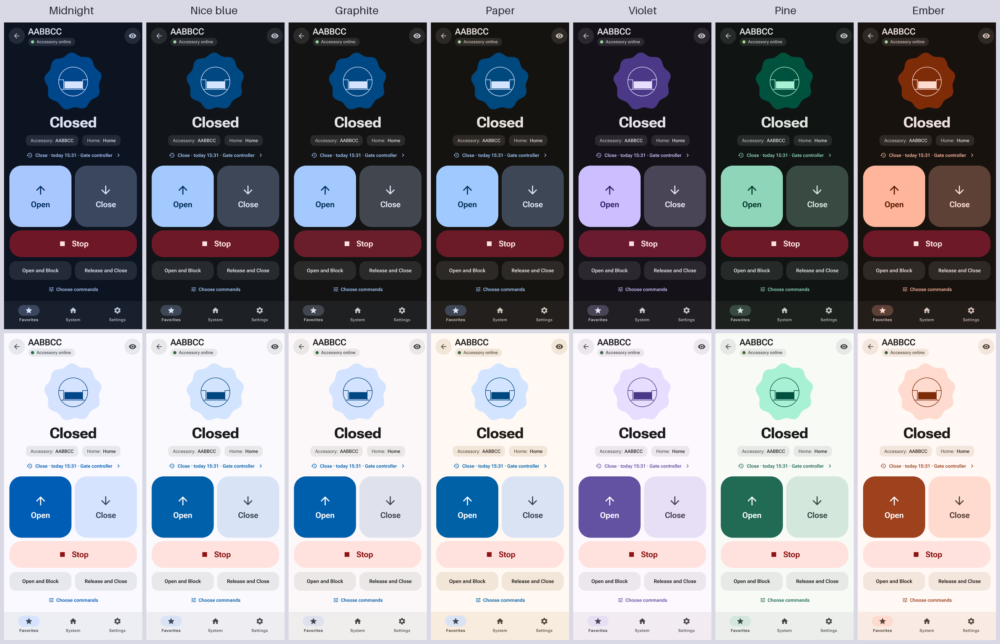
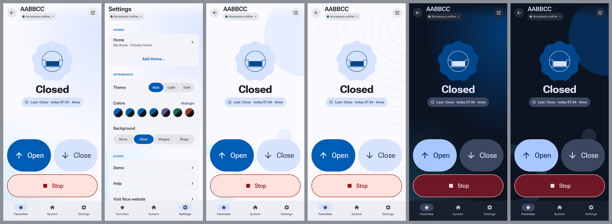

# MyNice Welcome patch (unofficial)

Patch scripts that turn **your own copy** of the *MyNice Welcome* 2.2.0 Android app (`com.nice.nhk`) into a build that works on
modern Android (10 and newer) with **Nice IT4WIFI** modules (Robus and other gate and garage-door openers). It also fixes the
app's trouble with VPNs and mobile data, adds a connection-status sheet with a real diagnosis, and gives the app a Material 3
Expressive look (light and dark), with a page inside the app that shows every part of that design as a working example. The latest builds (nx23, tidied up in nx24 and put on one grid in nx25) are the result of a design review: a gate
screen whose buttons never move, a line that says what became of every tap, and a state that says how old it is.

> **Unofficial, and not affiliated with Nice S.p.A.** The source tree of this repository contains **no Nice binaries**: you can
> build the patched app yourself, from an APK you obtained yourself, or take the prebuilt APK from the
> [Releases](../../releases) page. That one *is* Nice's app with the patches applied, so it contains Nice's code. See
> [Download or build](#download-or-build) and [NOTICE.md](NOTICE.md).
>
> **Gates and garage doors can hurt people.** This changes only the phone app; it does not touch the module or the motor
> controller. Use it at your own risk, with the gate in sight, and see the [license](LICENSE) (no warranty).


## What it fixes and adds

- **New in nx23: a design pass over the whole app.** Seven designers reviewed every screen in light and dark; 40 of their findings are built (the review, what was done and
  what was put off is in [docs/DETAILS.md](docs/DETAILS.md)):
  - **A gate screen that does not move.** The command pad is anchored to the bottom and nothing above it changes height, so a Blocked pill, a note or an obstruction never
    moves Open, Close or Stop. Stop is solid red whenever it may be needed.
  - **Every tap says what became of it.** A line above the pad: *Sending Open…*, *Open sent 12:03:41 · via cloud*, *No answer to Close. It may have arrived: check the gate.*,
    *Not sent*, with the cause and a Reconnect button when the accessory does not answer. A Stop that comes within 500 ms of another command, which the app ignored, is sent after all.
  - **A state says how old it is.** Live, *Checking…*, *Updated 12:03* or *Last confirmed 12:03* (with Refresh); after the app resumes it no longer shows the state of the last
    session as if it were live.
  - **A status that is an answer.** The chip is a real button, the sheet never opens by itself, and its verdict names the cause first and then one action.
  - **Nothing sits on the controls.** A request for access is a snack on the accessory screen (a popup elsewhere), the Debug log is a sheet that you can close, and the floating
    bug button is gone.
  - **For screen readers and keyboards.** Roles, names, headings, focus handling, Back and Escape for every dialog; the click of a key press or of TalkBack reaches the controls.
  - **Answers first.** Activity opens with what happened (a third shorter, charts that never draw an unknown day as zero), Favorites is a status card, the set-up says what it
    waits for, and the English of the original app is rewritten.
- **Pairing on Android 10+.** The wizard joins the accessory's Wi-Fi through Android's `WifiNetworkSpecifier` dialog (the old Wi-Fi
  APIs no longer work), falls back to the manual route, waits longer for slow modules, and fills in the home network when Android
  no longer lists known networks.
- **"Not usable" while the accessory is online.** When mDNS finds nothing, the app now tries the accessory's saved IP address,
  retries the reachability check, and rebuilds a stuck connection by itself.
- **No status before it is confirmed.** The app says "Not usable" as soon as the first attempt of a check fails, and right after startup
  it shows what the last session left behind. Now the lists and the status chip say "Checking…" until the result of the check (and its
  new attempts) is in, so a healthy accessory no longer flashes red.
- **VPN (Tailscale, WireGuard, ...) and mobile data.** A VPN that apps cannot bypass makes Android refuse the app's
  `Network.bindSocket` call (`EPERM`), and the original app does that on every connection, so everything failed with the VPN on.
  The patched app falls back to a normal socket. It also chooses between the local connection and the Nice cloud on what actually
  works, so it works away from home too (through the cloud).
- **Approve new users.** A request for access ("X wants access", for example from a Home Assistant integration) opens as a popup, except on the accessory screen, where it is a
  snack with a *Review* button so that nothing covers the controls. It says that it is working, and when it fails it says who and why (the app's own explanation of the error
  code), also in the log.
- **A connection status you can read.** A chip under the page title ("Accessory online · cloud", "Not reachable · no Wi-Fi"), a real button, and a sheet behind it that
  opens only when you ask: the verdict (the cause first, then one action), the route (phone, cloud, accessory), the measurements (TCP and TLS times) under Technical details,
  and buttons for *Reconnect*, *Check requests*, *Copy details* and *Debug log*.

  

- **A log without secrets, and without noise.** Passwords, setup codes and tokens are masked in the in-app log, and a log line that
  printed Wi-Fi passwords is gone. The Nice app's own repetitive debug lines (some 180 every time the accessory screen is opened, each
  with the whole home as JSON) are left out, so the lines that matter are still there when you copy the log.
- **More buttons on the accessory screen.** The app has one optional "fourth button"; every other command (*Open and Block*,
  *Release and Close*, ...) sits behind the eye icon. Now you tick as many of them as you like (Settings > your accessory > *Set the
  optional command*, or the *Choose commands* link on the accessory screen) and each becomes a button under Open, Close and Stop.
  A button runs its command at once, as the optional button does, and a short message confirms that it was sent.

  

- **Activity: what the gate has been doing.** The accessory keeps an event log. The app shows it in a small table and leaves out
  everything about the Wi-Fi module. A line on the accessory screen ("Close · today 14:12 · Anna") opens a sheet with the last opening and
  closing, the commands per day, who gave them, the busy hours, obstructions, how the Wi-Fi module is doing (restarts, Wi-Fi drops, a gate
  controller that was not found) and the history. It reads what the app's own *Historian of events* reads, so nothing leaves the phone.
  What the accessory does not tell: counters of maneuvers, motor current or temperature; its protocol has no such fields.

  

- **Blocked, and a state that is out of date.** The accessory has no state for "blocked", so no Nice app shows it. The last Block or Release
  command (from this phone, and from every phone and schedule in the accessory's log) now shows as a pill "Blocked · since 09:37" under the state,
  with a question mark when the accessory has restarted since (its log is forgotten at a restart, so a Release since then would not show). It is the
  last command and not a measurement: do not rely on it as security. A gate that moves is not blocked: when the gate controller reports a movement
  after the Block (Home Assistant opens the gate and it closes by itself, say), the pill goes away. It follows what other apps do: the official app, another phone or the schedule that blocks or
  releases the gate shows up here too, because the accessory's log is read again when the gate moves, when this app comes back to the front,
  and every 30 seconds while the accessory screen is open (a plain Block or Release moves nothing, so only the log can tell). And when the
  accessory still reports "opening" or "closing" long after the movement
  (a gate that was opened with *Open and Block* kept showing "Opening"), and the log has nothing that stopped the gate since, the screen shows open
  or closed, with the note "reported: Opening". The LOG has what the accessory says (status requests and events), to find out why a state is wrong.

  

- **"Connecting…" while the app tries again.** After a failed check the screen used to say *Not usable* (and the chip *not reachable*) while the app was, behind it,
  trying to connect again (when a screen is opened, when the app resumes, in the automatic recovery, or after *Reconnect*). Now the state line, the lists and the chip say
  *Connecting…* during such an attempt, and go back to what came of it when it is over. The chip also no longer runs under the eye button.
- **The logo of Nice as the icon, the notification icon and the splash screen.** The app has its own logo again, the blue *N in a house*, and now it is used properly: as an
  adaptive icon (on a white background, with a monochrome layer for the themed icons of Android 13), as the small icon of the notifications (the house with the N cut out; without a
  small icon of its own Android would show the launcher icon as a white blot in the status bar), and on a splash screen in the light or the dark surface color of the skin, so
  that the app does not open with a white flash at night (Android 12 and up show the same logo first). The logo is not in this repository and it is not redrawn: the build reads the
  icon of the app you patch (only 192 px) and rebuilds it as a gradient and two shapes, so that it can be drawn sharp at every size, without the light fringe of the original file.
  The launcher icons for Android 7 and older stay what they were. See [docs/DETAILS.md](docs/DETAILS.md).

- **A new look: Material 3 Expressive, with the real numbers.** The skin is made of the parts of M3 Expressive with the sizes, corners and springs of Google's own tokens (`androidx.compose.material3`): buttons in
  five sizes (Open and Close on the accessory screen are a connected button group of 96 dp, 136 dp on a tall screen, and the state of the gate is the button that is round all over), corners that morph when you
  press and when you select, segmented lists (2 dp apart, 4 dp inside, 16 dp at the ends), a switch with a check in the thumb, springs for every movement (with overshoot for what changes shape, without for color),
  and the 35 expressive shapes: the hero of the accessory screen is a cookie when the gate is closed, a flower when it is open, a clover when it is stopped and a burst when it is obstructed, and **while the gate moves
  (or the app connects) it is the loading indicator of M3 Expressive**, a shape that morphs through seven shapes while it turns; the spinners of the app are that too. It is a CSS layer, and no function of the app changed.

  

- **Settings > Design: Material 3 Expressive as an example.** A page in the app that shows every part of the design as something you can press, drag and switch: the 35 shapes (tap one and the big shape morphs into it), the six
  springs, buttons in five sizes and five styles (round and square, toggles that change shape), icon buttons, standard and connected button groups, the split button and its menu, the FAB and the FAB menu that unfolds, the
  loading indicator, wavy progress (determinate, flat and indeterminate), sliders in five sizes with a value bubble, switches, chips, floating and docked toolbars, a segmented list, the type scale with the emphasized styles, and
  the color roles of the palette you chose, which you can change on that page too. It is built with the very stylesheet of the app, so what the page shows is what the screens are made of, and every example has the numbers of the
  tokens and the class names under it. Meant as a reference for anyone who wants to use Material 3 Expressive in a web view: [docs/DETAILS.md](docs/DETAILS.md) tells where each part lives (`skin/src/m3e.css`).

  

- **Seven palettes to choose from.** Settings > Appearance > *Colors*: *Midnight* (the default: the blue of the Nice logo, on navy in the dark theme), *Nice blue*, *Graphite*, *Paper*,
  *Violet*, *Pine* and *Ember*; one tap and the whole app follows. The error color is a wine red instead of Material's saturated deep red, so that *Stop* and the red chip no longer
  shout. The text keeps its contrast in every palette (4.8:1 at the lowest; the tests check it). The splash screen has the colors of the default palette.

  

- **A backdrop, if you want one.** Settings > Appearance > *Background*: *None*, *Glow*, *Shapes* or *Rings*: a quiet abstract picture behind the header and the cards, drawn in the
  colors of the palette you chose, in the light and in the dark theme. Since nx25 everything also stands on one grid: every title on the same line, the header and the lists on the same
  16 dp, the label of a list above the text of its cards, and round ends on every run of cards.

  

- **Light, dark or automatic.** Settings > Appearance > *Theme*. *Auto* uses what the WebView reports as the phone's scheme, which is
  what the app did before. Android takes that value from the app's own theme, and the theme of the Nice app is a dark base theme, so
  *Auto* does not necessarily follow your phone (I could not check that on every phone); *Light* and *Dark* always do what they say.

The accessory is what the app calls it ("Add accessory"): the IT4WIFI (or CORE) Wi-Fi module of your gate opener.

## Download or build

### Prebuilt APK

The [Releases](../../releases) page has the prebuilt APK (`MyNiceWelcome_2.2.0_nx<number>.apk`), built with `./build.sh` from this repository (the release notes name the
commit) and signed with the maintainer's key. It is Nice's app with the patches applied, so it contains Nice's code: it is unofficial,
comes without warranty and can be removed at any time (see [NOTICE.md](NOTICE.md)). Compare what you downloaded with the SHA-256
values in the release notes. Then go to [Install](#install).

### Build it yourself

This way you don't have to trust a binary from someone else, and the app is signed with your own key.

#### What you need

- JDK 17 or newer (`javac` and `keytool`), Python 3, bash (Linux, macOS, WSL, or Git Bash on Windows) and `curl`.
- The original app: **MyNice Welcome 2.2.0 (build 90)**, package `com.nice.nhk`. The patches were written against the file with
  SHA-256 `115b403234f49726005905f52bcc4c8fbacc4f78e1f0c1d8adf3e28990f058ef`. Get it yourself: from your own phone if it is still
  installed (`adb shell pm path com.nice.nhk`, then `adb pull <path>`) or from an APK mirror. I don't host the original app. Every patch checks
  that its anchor text occurs exactly once, so a different build fails loudly instead of being patched wrongly.

#### Build

```
./get-tools.sh                               # once: downloads apktool and friends into ./tools, checked on SHA-256
./build.sh /path/to/MyNiceWelcome_2.2.0.apk
# result: out/MyNiceWelcome_2.2.0_nx28.apk
```

The first build creates **your own signing key** in `keys/` (with a random password in `keys/password.txt`). Keep that folder
private and never commit it: whoever has it can build an APK that installs over your app. Use the same key for every later build,
otherwise Android refuses to update the app and its data (the pairing with your accessory) is lost. To use an existing key:
`KS=/path/key.jks KSPASS=secret ./build.sh ...`.

## Install

The patched app is signed with a key that is not Nice's (the maintainer's for the prebuilt APK, yours when you build it yourself), so
Android won't install it over the official app: **uninstall the official MyNice Welcome first**. The accessory stays paired and
online, but the app's own data goes with it, so you pair again with the setup code on the back of the accessory (use the same user
name as before, otherwise the accessory asks the administrator for permission). Later builds signed with the same key install over
the previous one without losing anything. A prebuilt APK and a build of your own use different keys: switching from one to the
other means uninstalling and pairing again.

## Tests

```
npm install            # only for the jsdom tests
./get-tools.sh         # only for the Java tests (android-all)
./test-all.sh
```

That runs the checks of `nx-patch.js` in a simulated Angular/Cordova environment (jsdom), the log masking, the CSS itself (among them every number of the Material 3 Expressive
components against the tokens it comes from), the page Settings > Design in jsdom, and the logic of the native layer on a plain JVM. What no test can show: how the patched app behaves on a real phone, a real VPN or your
accessory. I developed it against one phone and one IT4WIFI module, diagnosing from that phone's logs.

`harness/` can also run the app's screens in headless Chromium with a simulated Cordova bridge and take screenshots (that is how
the pictures in this README were made, with made-up data; `harness/make-screenshots.py` redoes them); see `harness/README.md`.

## How it works

Three layers, applied by the `patch-*.py` scripts to the unpacked app:

1. **Hooks in the app's smali** (`ConnectionsManager`, `WifiWizard`, `JmDNSDiscoveryService`, the manifest and `config.xml`) that call
   into the new code.
2. **A native layer** `com.nice.patch` (`java/src`, compiled to a second dex): `Nx` (network state, probes, local-or-cloud choice,
   the socket fallback), `NxWifi` (joining the accessory's Wi-Fi) and `NxPlugin` (the Cordova bridge to JavaScript).
3. **A JavaScript layer** in the WebView: `nx-patch.js` (status chip and sheet, diagnosis, user approval, automatic recovery),
   `debuglog.js` (the log), `nx-gallery.js` (the page Settings > Design) and the skin in `skin/` (generated from `skin/src/` by `build-css.py`; change the source, not the result:
   `m3e.css` is the library of Material 3 Expressive components, `shapes.json` the 35 shapes that `tools/build-shapes.py` makes).

The full notes, with the diagnoses that led to each fix, are in [docs/DETAILS.md](docs/DETAILS.md).

## Home Assistant

The folder [homeassistant/](homeassistant/) holds a Home Assistant integration for the same module (*Nice Gate*, local, over the same NHK protocol): a cover,
a status sensor, buttons for the other commands and a diagnostics download. Since its version 1.7.0 it keeps one session to the module open and follows the
changes that the module pushes, instead of opening a new TLS session for every poll and every command. It is independent of the app: see
[homeassistant/README.md](homeassistant/README.md). That folder is under the Apache License 2.0 (it started from another project), not under the licence below.

## Known limits

- Only version 2.2.0 (90) of the app. Newer builds need new anchors.
- On a network that uses the same address range as your home (192.168.1.x at someone else's house) the app tries the home address
  first, so the cloud route is not tried there.
- The skin uses CSS `:has()`, spring easing (`linear()`), `@property`, `color-mix()` and container query units: fully visible from Android System WebView 113; an older WebView loses
  some shapes and animations, not the function.
- The app's own screens follow the phone's language (the app ships 17 languages). The texts this patch adds (status chip and sheet,
  diagnosis, approval popup, error messages) are English only; translations are welcome, the strings are in `nx-patch.js`.
- Only the Latin subset of Roboto Flex is included.
- A status sheet that you open yourself covers the command pad (one tap on the scrim closes it), and the app's own alert after a failed command still lands on the pad.
- A Stop within 500 ms of another command, which the original app ignores, is now sent from here (`STOP_BYPASS` in `nx-patch.js`); try it on your own gate before you rely on it
  (see [docs/DETAILS.md](docs/DETAILS.md)).

## Contributing

Issues are welcome, with the text from the status sheet (*Technical details* > *Copy*); the issue form says how. No support is
promised. Please don't attach APKs or the original app.

## License

MIT for the code in this repository (see [LICENSE](LICENSE)); third-party parts are listed in [NOTICE.md](NOTICE.md). The license
does not cover the Nice app that the scripts patch.
