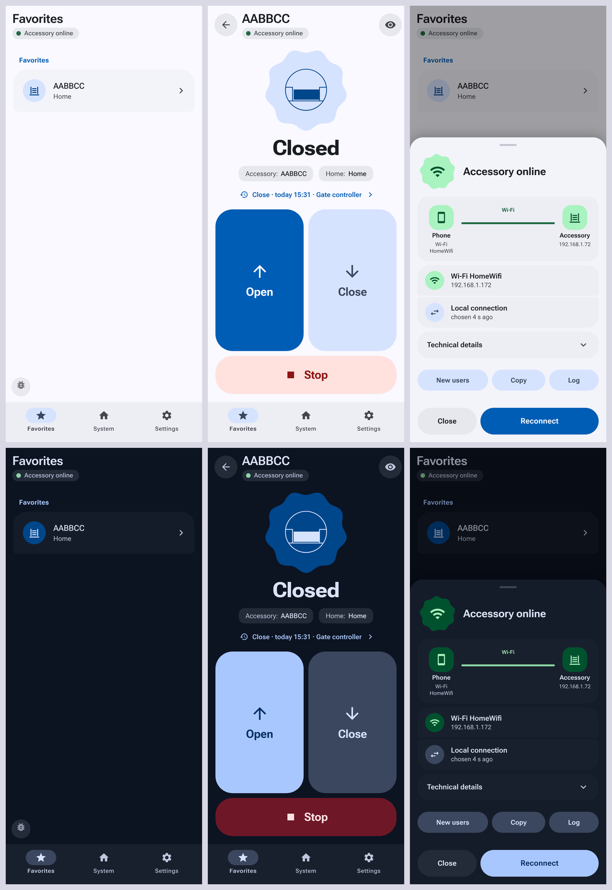
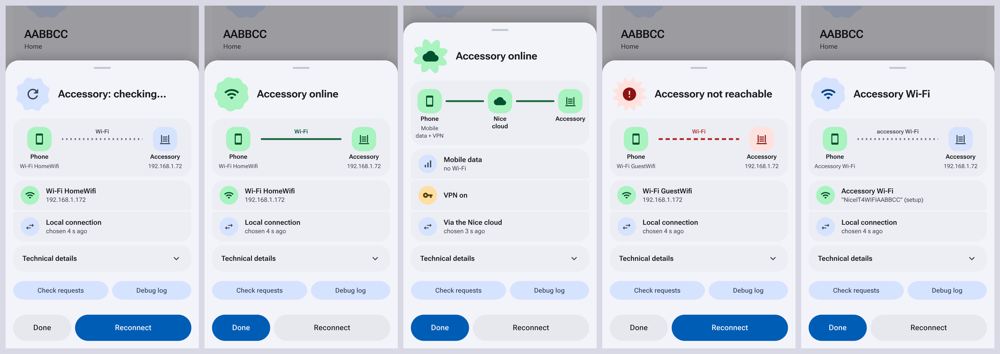
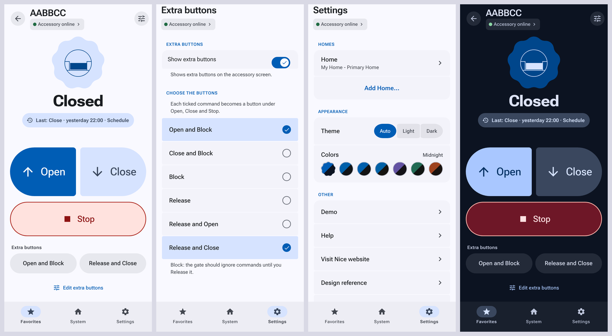
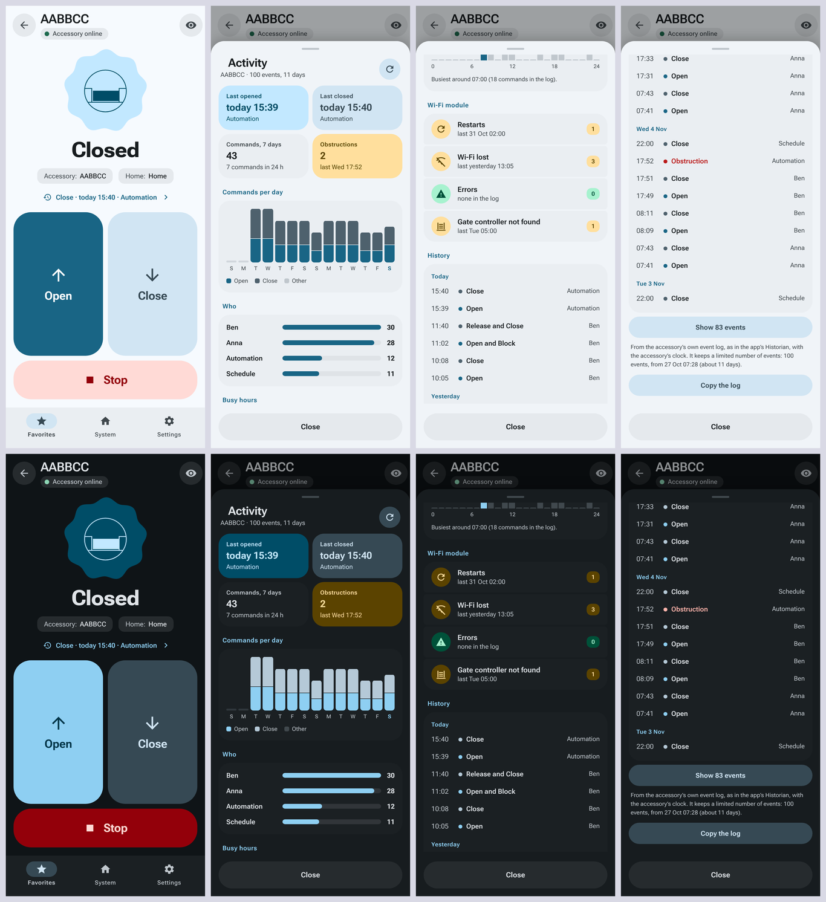
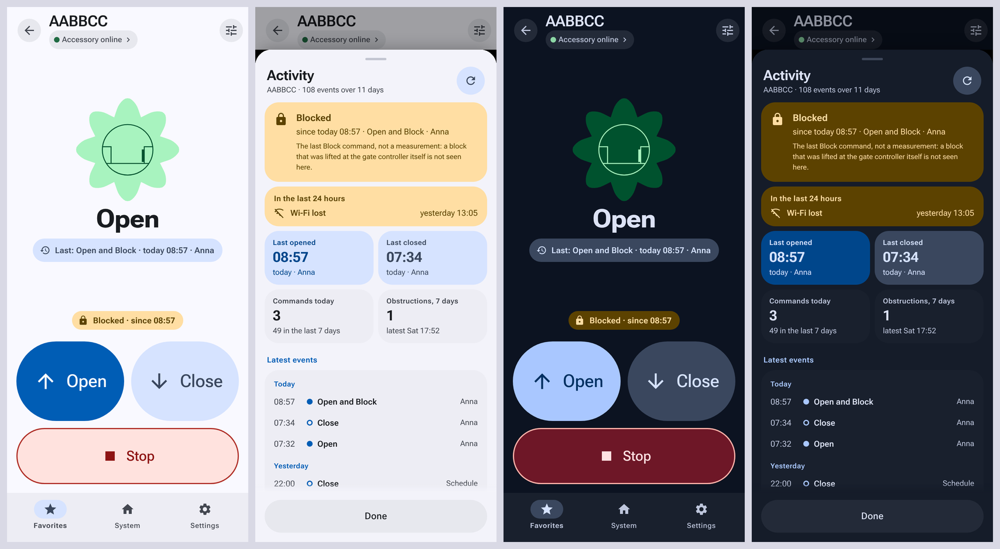
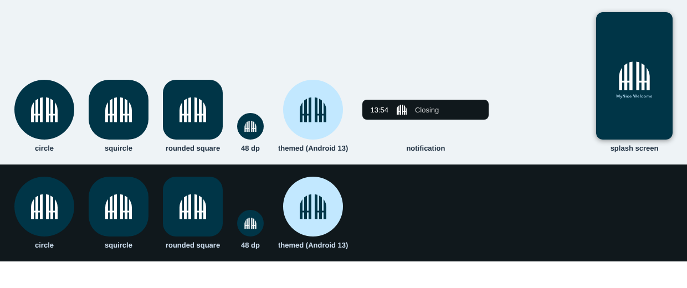

# MyNice Welcome patch (unofficial)

Patch scripts that turn **your own copy** of the *MyNice Welcome* 2.2.0 Android app (`com.nice.nhk`) into a build that works on
modern Android (10 and newer) with **Nice IT4WIFI** modules (Robus and other gate and garage-door openers). It also fixes the
app's trouble with VPNs and mobile data, adds a connection-status sheet with a real diagnosis, and gives the app a Material 3
Expressive look (light and dark).

> **Unofficial, and not affiliated with Nice S.p.A.** The source tree of this repository contains **no Nice binaries**: you can
> build the patched app yourself, from an APK you obtained yourself, or take the prebuilt APK from the
> [Releases](../../releases) page. That one *is* Nice's app with the patches applied, so it contains Nice's code. See
> [Download or build](#download-or-build) and [NOTICE.md](NOTICE.md).
>
> **Gates and garage doors can hurt people.** This changes only the phone app; it does not touch the module or the motor
> controller. Use it at your own risk, with the gate in sight, and see the [license](LICENSE) (no warranty).



## What it fixes and adds

- **Pairing on Android 10+.** The wizard joins the accessory's Wi-Fi through Android's `WifiNetworkSpecifier` dialog (the old Wi-Fi
  APIs no longer work), falls back to the manual route, waits longer for slow modules, and fills in the home network when Android
  no longer lists known networks.
- **"Not usable" while the accessory is online.** When mDNS finds nothing, the app now tries the accessory's saved IP address,
  retries the reachability check, and rebuilds a stuck connection by itself.
- **No status before it is confirmed.** The app says "Not usable" as soon as the first attempt of a check fails, and right after startup
  it shows what the last session left behind. Now the lists and the status chip say "Checking…" until the result of the check (and its
  new attempts) is in, so a healthy accessory no longer flashes red.
- **VPN (Tailscale, WireGuard, ...) and mobile data.** A VPN that apps cannot bypass makes Android refuse the app's
  `Network.bindSocket` call (`EPERM`), and the original app does that on every connection, so everything failed with the VPN on.
  The patched app falls back to a normal socket. It also chooses between the local connection and the Nice cloud on what actually
  works, so it works away from home too (through the cloud).
- **Approve new users.** A popup "X requests access" for pairing requests, for example from a Home Assistant integration. It says that
  it is working, and when it fails it says why (the app's own explanation of the error code), also in the log.
- **A connection status you can read.** A chip under the page title ("Accessory online · cloud", "Accessory not reachable · no
  Wi-Fi, VPN, mobile"), and a sheet behind it with the route (phone, cloud, accessory), the measurements (TCP and TLS times),
  plain-language advice and buttons for *Reconnect*, *New users*, *Copy* and *Log*.

  

- **A log without secrets, and without noise.** Passwords, setup codes and tokens are masked in the in-app log, and a log line that
  printed Wi-Fi passwords is gone. The Nice app's own repetitive debug lines (some 180 every time the accessory screen is opened, each
  with the whole home as JSON) are left out, so the lines that matter are still there when you copy the log.
- **More buttons on the accessory screen.** The app has one optional "fourth button"; every other command (*Open and Block*,
  *Release and Close*, ...) sits behind the eye icon. Now you tick as many of them as you like (Settings > your accessory > *Set the
  optional command*, or the *Choose commands* link on the accessory screen) and each becomes a button under Open, Close and Stop.
  A button runs its command at once, as the optional button does, and a short message confirms that it was sent.

  

- **Activity: what the gate has been doing.** The accessory keeps an event log. The app shows it in a small table and leaves out
  everything about the Wi-Fi module. A line on the accessory screen ("Close · today 14:12 · Anna") opens a sheet with the last opening and
  closing, the commands per day, who gave them, the busy hours, obstructions, how the Wi-Fi module is doing (restarts, Wi-Fi drops, a gate
  controller that was not found) and the history. It reads what the app's own *Historian of events* reads, so nothing leaves the phone.
  What the accessory does not tell: counters of maneuvers, motor current or temperature; its protocol has no such fields.

  

- **Blocked, and a state that is out of date.** The accessory has no state for "blocked", so no Nice app shows it. The last Block or Release
  command (from this phone, and from every phone and schedule in the accessory's log) now shows as a pill "Blocked · since 09:37" under the state,
  with a question mark when the accessory has restarted since (its log is forgotten at a restart, so a Release since then would not show). It is the
  last command and not a measurement: do not rely on it as security. A gate that moves is not blocked: when the gate controller reports a movement
  after the Block (Home Assistant opens the gate and it closes by itself, say), the pill goes away. It follows what other apps do: the official app, another phone or the schedule that blocks or
  releases the gate shows up here too, because the accessory's log is read again when the gate moves, when this app comes back to the front,
  and every 30 seconds while the accessory screen is open (a plain Block or Release moves nothing, so only the log can tell). And when the
  accessory still reports "opening" or "closing" long after the movement
  (a gate that was opened with *Open and Block* kept showing "Opening"), and the log has nothing that stopped the gate since, the screen shows open
  or closed, with the note "reported: Opening". The LOG has what the accessory says (status requests and events), to find out why a state is wrong.

  

- **"Connecting…" while the app tries again.** After a failed check the screen used to say *Not usable* (and the chip *not reachable*) while the app was, behind it,
  trying to connect again (when a screen is opened, when the app resumes, in the automatic recovery, or after *Reconnect*). Now the state line, the lists and the chip say
  *Connecting…* during such an attempt, and go back to what came of it when it is over. The chip also no longer runs under the eye button.
- **A new icon and splash screen.** The blue *N in a house* and the black *Welcome to your Nice World!* picture are replaced by an arched picket gate, white on the petrol blue of the skin:
  six boards of one width under one arch (an exact semicircle), a gap between the two leaves, one rail. It is built, not drawn: five numbers on a grid (see
  [brand/build-brand.py](brand/build-brand.py)), so that the edges lie on whole units, and on whole pixels in the PNG files. It comes as an adaptive icon (with a monochrome layer for themed
  icons), a small icon for the notifications (without it Android would show the launcher icon as a white blot in the status bar), and a splash screen that is no longer stretched to the
  screen. Android 12 and up show the same field first.

  

- **A new look.** Material 3 Expressive in a calm petrol blue: one color family for the surfaces and the buttons, a gate icon that
  changes shape with its state. It has a light and a dark palette; it is a CSS layer, and no function of the app changed.
- **Light, dark or automatic.** Settings > Appearance > *Theme*. *Auto* uses what the WebView reports as the phone's scheme, which is
  what the app did before. Android takes that value from the app's own theme, and the theme of the Nice app is a dark base theme, so
  *Auto* does not necessarily follow your phone (I could not check that on every phone); *Light* and *Dark* always do what they say.

The accessory is what the app calls it ("Add accessory"): the IT4WIFI (or CORE) Wi-Fi module of your gate opener.

## Download or build

### Prebuilt APK

The [Releases](../../releases) page has the prebuilt APK (`MyNiceWelcome_2.2.0_nx<number>.apk`), built with `./build.sh` from this repository (the release notes name the
commit) and signed with the maintainer's key. It is Nice's app with the patches applied, so it contains Nice's code: it is unofficial,
comes without warranty and can be removed at any time (see [NOTICE.md](NOTICE.md)). Compare what you downloaded with the SHA-256
values in the release notes. Then go to [Install](#install).

### Build it yourself

This way you don't have to trust a binary from someone else, and the app is signed with your own key.

#### What you need

- JDK 17 or newer (`javac` and `keytool`), Python 3, bash (Linux, macOS, WSL, or Git Bash on Windows) and `curl`.
- The original app: **MyNice Welcome 2.2.0 (build 90)**, package `com.nice.nhk`. The patches were written against the file with
  SHA-256 `115b403234f49726005905f52bcc4c8fbacc4f78e1f0c1d8adf3e28990f058ef`. Get it yourself: from your own phone if it is still
  installed (`adb shell pm path com.nice.nhk`, then `adb pull <path>`) or from an APK mirror. I don't host the original app. Every patch checks
  that its anchor text occurs exactly once, so a different build fails loudly instead of being patched wrongly.

#### Build

```
./get-tools.sh                               # once: downloads apktool and friends into ./tools, checked on SHA-256
./build.sh /path/to/MyNiceWelcome_2.2.0.apk
# result: out/MyNiceWelcome_2.2.0_nx19.apk
```

The first build creates **your own signing key** in `keys/` (with a random password in `keys/password.txt`). Keep that folder
private and never commit it: whoever has it can build an APK that installs over your app. Use the same key for every later build,
otherwise Android refuses to update the app and its data (the pairing with your accessory) is lost. To use an existing key:
`KS=/path/key.jks KSPASS=secret ./build.sh ...`.

## Install

The patched app is signed with a key that is not Nice's (the maintainer's for the prebuilt APK, yours when you build it yourself), so
Android won't install it over the official app: **uninstall the official MyNice Welcome first**. The accessory stays paired and
online, but the app's own data goes with it, so you pair again with the setup code on the back of the accessory (use the same user
name as before, otherwise the accessory asks the administrator for permission). Later builds signed with the same key install over
the previous one without losing anything. A prebuilt APK and a build of your own use different keys: switching from one to the
other means uninstalling and pairing again.

## Tests

```
npm install            # only for the jsdom tests
./get-tools.sh         # only for the Java tests (android-all)
./test-all.sh
```

That runs the checks of `nx-patch.js` in a simulated Angular/Cordova environment (jsdom), the log masking, the CSS itself, and the
logic of the native layer on a plain JVM. What no test can show: how the patched app behaves on a real phone, a real VPN or your
accessory. I developed it against one phone and one IT4WIFI module, diagnosing from that phone's logs.

`harness/` can also run the app's screens in headless Chromium with a simulated Cordova bridge and take screenshots (that is how
the pictures in this README were made, with made-up data; `harness/make-screenshots.py` redoes them); see `harness/README.md`.

## How it works

Three layers, applied by the `patch-*.py` scripts to the unpacked app:

1. **Hooks in the app's smali** (`ConnectionsManager`, `WifiWizard`, `JmDNSDiscoveryService`, the manifest and `config.xml`) that call
   into the new code.
2. **A native layer** `com.nice.patch` (`java/src`, compiled to a second dex): `Nx` (network state, probes, local-or-cloud choice,
   the socket fallback), `NxWifi` (joining the accessory's Wi-Fi) and `NxPlugin` (the Cordova bridge to JavaScript).
3. **A JavaScript layer** in the WebView: `nx-patch.js` (status chip and sheet, diagnosis, user approval, automatic recovery),
   `debuglog.js` (the log) and the skin in `skin/` (generated from `skin/src/` by `build-css.py`; change the source, not the result).

The full notes, with the diagnoses that led to each fix, are in [docs/DETAILS.md](docs/DETAILS.md).

## Known limits

- Only version 2.2.0 (90) of the app. Newer builds need new anchors.
- On a network that uses the same address range as your home (192.168.1.x at someone else's house) the app tries the home address
  first, so the cloud route is not tried there.
- The skin uses CSS `:has()` and spring easing (`linear()`): fully visible from Android System WebView 113; an older WebView loses
  some shapes and animations, not the function.
- The app's own screens follow the phone's language (the app ships 17 languages). The texts this patch adds (status chip and sheet,
  diagnosis, approval popup, error messages) are English only; translations are welcome, the strings are in `nx-patch.js`.
- Only the Latin subset of Roboto Flex is included.

## Contributing

Issues are welcome, with the text from the status sheet (*Technical details* > *Copy*); the issue form says how. No support is
promised. Please don't attach APKs or the original app.

## License

MIT for the code in this repository (see [LICENSE](LICENSE)); third-party parts are listed in [NOTICE.md](NOTICE.md). The license
does not cover the Nice app that the scripts patch.
